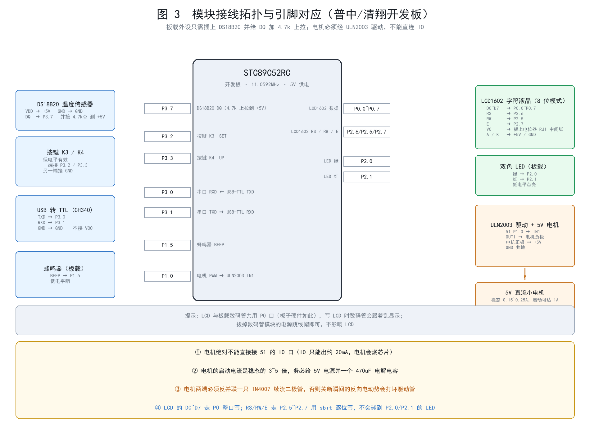
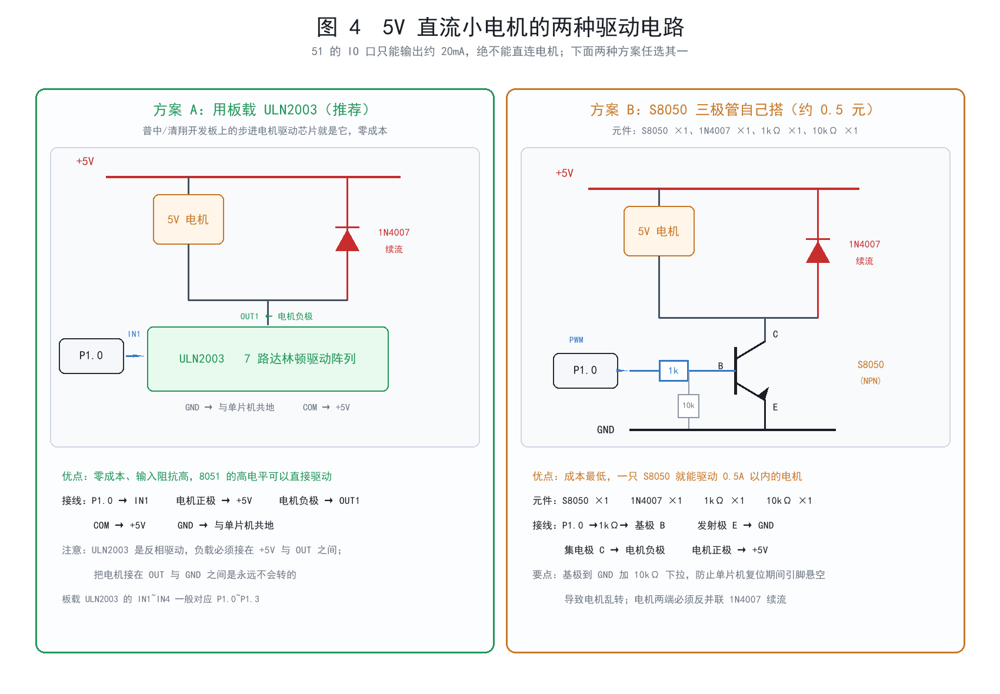

# DS18B20 智能温控散热系统

> 《智能硬件》课程作品 · STC89C52RC + Keil C51
> 用 51 单片机**纯软件 PWM** 实现的四档温控调速器

---

## 制作过程中真实踩的坑

这个项目**不是一次写完就跑通的**。下面几条都是**上真机之后**才暴露的问题，
每一条都改了代码或接线：

| 现象 | 真正的原因 |
|---|---|
| STC-ISP 报"文件太大"、烧不进去 | 烧录软件里的芯片型号没真正选中（芯片本身有 8KB） |
| 一直卡在"正在检测目标单片机" | 串口被占死 + 冷启动顺序不对（要先点下载、再给板子上电） |
| 烧到 62% 就断开 | 用"拔 USB"当冷启动，CH340 会跟着一起掉电 |
| **液晶只显示一排黑方块** | **按"自己接线"的思路把 LCD 设计在 P1 口，但这块板的 LCD 是插在专用插座上的、接线出厂焊死，实际在 P0 + P2.5~P2.7** |
| 串口偶尔出现 `$S,$S,...` 这种畸形帧 | 串口中断发送和主循环拼帧之间的竞态 |

第 4 条排查了两轮，最后是**从实物照片上**才看出"原来是插座直连、不是杜邦线"。
教训：**用开发板之前，先确认板子的外设到底是怎么连的，再决定代码怎么写。**

完整的排查过程见 [docs/09-制作过程问题与解决办法](docs/09-制作过程问题与解决办法.md)。


---

## 它做什么

用 **DS18B20** 持续测量温度，以**目标温度**为中心划分四个调节档位，
用 **51 单片机纯软件 PWM** 驱动 5V 直流小电机分档调速，
并在 **LCD1602 字符液晶**上实时显示温度、目标温度、运行模式和占空比。

```
   温度变化 → DS18B20 → 四档阶梯回差判定 → 占空比 → 软件 PWM → 电机转速
        ↑                                                          │
        └──────────────── 闭环，每 100ms 判定一次 ─────────────────┘
```


---

## 核心亮点

| 亮点 | 说明 |
|---|---|
| **四档阶梯回差（迟滞）** | 每次切换都有独立的"进档阈值"和"退档阈值"，中间留 2℃ 死区。实测把临界抖动时的档位切换 **从 100 次降到 1 次** |
| **51 上的软件 PWM** | 8051 没有硬件 PWM，STC89C52 也没有 PCA 模块。用定时器 0 每 200µs 中断一次做 50 级 PWM，**100Hz**，CPU 占用仅 18% |
| **一个中断干三件事** | Timer1 被串口波特率占用，只剩 Timer0。PWM、毫秒计时、按键采样全部塞进这**一个**中断里（改用液晶后不再需要数码管扫描，中断服务变短，CPU 占用从 18% 降到约 13%） |
| **非阻塞 DS18B20 采样** | 转换要 750ms，拆成「发起转换 → 等 800ms → 读结果」两阶段，期间主循环照常响应按键和串口 |
| **传感器故障保护** | 连续 3 次读失败即判故障，**电机强制停转** + 长鸣告警，而不是拿最后一次的温度瞎转 |
| **SIM 温度注入** | 内置 `SIM T=42.5` 命令可绕过真实传感器，让测试 **100% 可复现**，器件到货前就能验证逻辑 |
| **LCD1602 两行显示** | 4 位数据模式 + RW 接地，只占 6 根 IO，全部放在 P1 的空闲脚上；代码用 sbit 逐位写，不会冲掉同口的电机 PWM 和蜂鸣器 |
| **独立的自检固件** | `tools\build_selftest.bat` 单独编一份只做硬件体检的固件（**不链接 app.c**，省 2KB Flash），30 秒确认接线 |
| **7 种可演示状态** | 停机 / 低速 / 中速 / 全速 / 报警 / 传感器故障 / 手动 |

---

## 硬件清单

### 你已经有的（不用买）

| 元件 | 说明 |
|---|---|
| 普中 / 清翔 系列 51 开发板 | 板载 STC89C52RC、11.0592MHz 晶振、独立按键 K1~K4、蜂鸣器、LED、DS18B20 座、**ULN2003**、CH340 下载电路 |
| **LCD1602 字符液晶** | 16 字 × 2 行，本项目的主显示器 |
| DS18B20 温度传感器 | 单总线 |
| 5V 直流小电机 | |

### 需要补的（最小方案约 10~25 元）

| 元件 | 规格 | 用途 |
|---|---|---|
| **10kΩ 电位器** | 直插，调对比度用 | **LCD1602 的 V0 脚**，不接好屏幕就是空白的 |
| 4.7kΩ 电阻 | 金属膜，1/4W | DS18B20 的 DQ 上拉（板上若已有则不用买） |
| **1N4007 二极管** | 直插 | 电机续流，**必须** |
| **470µF 电解电容** | 16V | 吸收电机启动电流冲击 |
| 杜邦线套装 | 公对公/公对母 | 接线 |

**如果板子上没有 ULN2003**，再买一个 ULN2003 驱动模块（约 2~4 元），
或者用 S8050 + 1kΩ + 10kΩ + 1N4007 自己搭（约 0.5 元）。

详细清单、价格区间和 12 个新手避坑点见 [采购清单](docs/02-选型与采购清单.md)。

---

## 引脚分配速查表

| 引脚 | 功能 | 方向 | `config.h` 宏 |
|---|---|---|---|
| **P0.0 ~ P0.7** | **LCD1602 数据 D0~D7**（整口写） | 输出 | `LCD_DATA_PORT` |
| **P2.5 / P2.6 / P2.7** | **LCD1602 RW / RS / EN** | 输出 | `LCD_RW` / `LCD_RS` / `LCD_EN` |
| **P1.0** | 电机 PWM → ULN2003 IN1 | 输出 | `MOTOR` |
| **P1.5** | 蜂鸣器 | 输出 | `BEEP` |
| **P2.0 / P2.1** | LED 绿 / 红 | 输出 | `LED_G` / `LED_R` |
| **P3.0 / P3.1** | 串口 RXD / TXD | — | 硬件固定 |
| **P3.2 / P3.3** | 按键 K3(SET) / K4(UP) | 输入 | `KEY_SET` / `KEY_UP` |
| **P3.7** | DS18B20 DQ（需 4.7k 上拉到 +5V） | 双向 | `DQ` |
| *(P2.2~P2.4)* | *(板载数码管位选，本项目弃用)* | — | `SMG_OFF_MASK` |

> 按键特意只用 K3/K4，把 P3.0/P3.1 完整留给串口，**按键和串口可以同时用**。
>
> ⚠️ **这几组引脚是「跟着开发板走」的，不是我们自己挑的。**
> 普中 PZ-51 实验板上的 **LCD1602 是插在专用插座上的，插座内部已经焊死**，
> 接线固定为 `D0~D7 → P0`、`RS/RW/E → P2.6/P2.5/P2.7`。
> 早期版本按"自己接线"的思路设计成 P1 口，插上后**屏幕只有一排黑方块**。

**LCD1602 接线（普中 PZ-51 板载插座，不用自己接）**（完整表格见 [03-硬件接线](docs/03-硬件接线与引脚分配.md)）：

| LCD 引脚 | 板上固定接到 |
|---|---|
| VSS / VDD | GND / +5V |
| **V0** | 板上对比度电位器 **RJ1** 的中间脚 |
| RS / RW / E | **P2.6 / P2.5 / P2.7** |
| D0~D7 | **P0.0 ~ P0.7**（8 位模式） |
| A / K | +5V / GND |

> ⚠️ P0 **同时**接到板载数码管的段选，所以写 LCD 时数码管会跟着乱显示。
> 拔掉数码管模块的电源跳线帽（板上标着 `J24` 之类）即可，不影响 LCD。



**电机必须经驱动器，不能直连 IO** —— 两种电路的完整画法：



---

## 目录结构

```
stc51-temp-fan/
├─ README.md                          本文件
├─ docs/
│   ├─ 01-产品说明与设计思路.md         ★ 设计原则、判定逻辑、状态表、决策一览
│   ├─ 02-选型与采购清单.md             已有装备盘点、缺口元件、预算、避坑
│   ├─ 03-硬件接线与引脚分配.md         逐引脚接线表、电机驱动电路、自检清单
│   ├─ 04-Keil编译与下载.md            建工程、编译设置、STC-ISP 烧录、报错表
│   ├─ 05-测试方案与判定标准.md         三层测试方案 + 实测记录表模板
│   ├─ 06-测试记录-自动生成.csv         270 条逐条测试原始记录
│   ├─ 07-测试报告-自动生成.md          测试结论与专项验证
│   ├─ 08-现场演示流程.md     6 分钟演示流程 + 讲解预案 + 翻车急救
│   ├─ 09-制作过程问题与解决办法.md     18 个真实踩坑与解决办法
│   └─ images/                         4 张设计图
├─ firmware/                           Keil C51 工程源文件（11 个 .c + 12 个 .h）
│   ├─ config.h                        ★ 唯一事实来源：引脚、参数、协议
│   └─ ...
└─ tools/
    ├─ lint_c51.py                     C51 源码静态自检（含 C89 块内声明检查）
    ├─ sim_controller.py               控制逻辑等价仿真 + 自动化回归测试
    ├─ verify_serial_cases.py          校验串口测试脚本的期望值是否正确
    ├─ check_consistency.py            文档与代码一致性校验
    ├─ gen_diagrams.py                 4 张设计图生成器
    ├─ build.bat                       ★ 一键编译正式固件（双击即可，不需要开 IDE）
    ├─ build_selftest.bat              ★ 一键编译自检固件（不链接 app.c，省 2KB Flash）
    ├─ build_minimal.bat               ★ 一键编译 4KB 精简版（给只有 4KB 的芯片用）
    └─ serial_test.ps1                 实物串口自动化测试（零依赖）
```

---

## 快速开始

### 0. 想跳过编译？直接用预编译好的 hex

`hex/` 目录里已经放好了**三个**可以直接烧的固件，**按你的芯片容量挑一个**：

| 文件 | 用途 | 实际占 Flash | 需要芯片容量 | 有串口？ |
|---|---|---|---|---|
| `hex/TempFan_Selftest.hex` | **先烧这个**：硬件自检，逐个演示每个外设 | 5111 字节 | ≥ **8KB** | ✅ |
| `hex/TempFan.hex` | 自检通过后烧这个：**完整版**正式固件 | 6362 字节 | ≥ **8KB** | ✅ |
| `hex/TempFan_4K.hex` | **只有 4KB 的芯片烧这个**：精简版正式固件 | **3502 字节** | ≥ **4KB** | ❌ 无 |

> **怎么知道该烧哪个？** 在 STC-ISP 里选好型号后，如果打开 8KB 那两个报
> "文件太大"，就说明你的芯片只有 4KB —— 直接烧 **`TempFan_4K.hex`**。
>
> **4K 版少了什么**：串口通信（命令行解析 + 每秒上报帧）、SIM 模拟温度注入、手动模式。
> **核心功能一个不少**：DS18B20 测温、按键调目标温度、四档阶梯回差自动调速、
> 软件 PWM 驱动电机、LCD1602 显示、声光报警、传感器故障保护。
> 详见 [docs/04 §0.7](docs/04-Keil编译与下载.md)。

### 1. 编译（改代码之后需要）

**双击 `tools\build.bat`** 编正式固件，**双击 `tools\build_selftest.bat`** 编自检固件。
两个脚本会自动编译、链接、生成 hex 并复制到 `hex\` 目录。

如果 Keil 不在 `D:\Keil_v5`，用记事本改这两个脚本里的 `set KEIL=`。

> **为什么自检要单独编一份？**
> 自检版**不链接 `app.c`**（主循环不跑应用层）。如果两套代码编在一起，
> 自检固件会达到 **8628 字节，超过 STC89C52 的 8192 字节 Flash 上限，根本烧不进去**。
> 拆开之后自检版只有 5111 字节。
> 好处是：`SELFTEST_MODE` 由命令行 `DEFINE()` 传入，**你不需要手动改宏，也就不会忘记改回来**。

用 IDE 的话：Keil uVision5 + **C51** 编译器（不是 MDK-ARM），
把 `firmware/` 下对应的 `.c` 文件加入，Include Paths 加上 `firmware` 目录，
勾选 **Create HEX File**，内存模型选 **Small**。

实测编译结果（已在本机用 **C51 V9.60.7** 验证，编译与链接均 0 错误）：

```
Program Size: data=84.0  xdata=175  code=6362     ← 正式固件（含 app.c）
Program Size: data=95.0  xdata=96   code=5111     ← 自检固件（不含 app.c）
```

> ⚠️ **`data` 必须小于 128 字节**（STC89C52 只有 128 字节可直接寻址 RAM）。
> 加新全局变量后如果链接报 `L107 ADDRESS SPACE OVERFLOW`，
> 给变量加 `xdata` 关键字。原理见 [04-Keil编译与下载](docs/04-Keil编译与下载.md) §0.6。
>
> ⚠️ **`code` 必须小于 8192 字节**（8KB Flash）。自检版曾经超到 8628 字节，
> 就是靠"不链接 app.c"才降下来的。
>
> ⚠️ Keil C51 是 **C89** 编译器，变量声明必须放在块首。
> 本工程已全部符合（用 `tools/lint_c51.py` 自动检查过）。

### 2. 接线

按 [03-硬件接线与引脚分配](docs/03-硬件接线与引脚分配.md) 接线。四条硬性规则：

1. **LCD1602 的 V0 必须接 10kΩ 电位器**（不接好屏幕就是空白的）
2. **电机不能直连 IO**，必须经 ULN2003 或三极管
3. **电机要独立 5V 供电 + 共地 + 470µF 电容**
4. **DS18B20 的 DQ 必须 4.7kΩ 上拉到 +5V**

### 3. 先用自检固件体检

**烧 `hex/TempFan_Selftest.hex`**（或双击 `tools\build_selftest.bat` 自己编一个）。
程序会依次演示 LCD1602、LED、蜂鸣器、电机四档、DS18B20、按键，
串口会打印每一项的排查建议。

**体检完烧 `hex/TempFan.hex` 进入正式运行。**

### 4. 用 STC-ISP 烧录

选 `STC89C52RC`、选 COM 口、打开 `.hex`，
点"下载/编程"后**给板子断电再上电**（冷启动）。

---

## 串口协议

**参数：9600 8N1**（注意不是 115200！12MHz 晶振的板子自动降级为 4800）

**上位机 → 板卡**（ASCII 文本，以换行结尾）

| 命令 | 说明 | 示例 |
|---|---|---|
| `SIM T=<温度>` | 注入模拟温度，进入仿真模式（忽略真实传感器） | `SIM T=42.5` |
| `SIM OFF` | 退出仿真模式 | `SIM OFF` |
| `MODE AUTO` / `MODE MANUAL` | 切换运行模式 | `MODE MANUAL` |
| `SET T=<温度>` | 设置目标温度（限幅 20.0~60.0℃） | `SET T=25.0` |
| `LEVEL <0\|1\|2\|3>` | 手动模式下直接指定档位 | `LEVEL 3` |
| `STATUS` | 立即回一帧 | `STATUS` |
| `RESET` | 恢复默认参数并清除报警 | `RESET` |

**板卡 → 上位机**（10 个数据字段，每 1 秒一帧，状态变化时立即补发）

```
$S,<ms>,<T>,<SET>,<LEVEL>,<DUTY>,<ST>,<MODE>,<BUZ>,<SIM>,<SENSOR>
```

| 字段 | 含义 |
|---|---|
| `ms` | 上电以来的毫秒数（低 16 位，约 65.5 秒回绕一次） |
| `T` / `SET` | 当前温度 / 目标温度，**定点 ×10**：`355` 表示 35.5℃ |
| `LEVEL` | 档位 0~3（0=停机 1=低速 2=中速 3=全速） |
| `DUTY` | PWM 占空比百分数：0 / 34 / 66 / 100 |
| `ST` | 状态名：`STOP` `LOW` `MID` `HIGH` `ALARM` `FAULT` `MANUAL` |
| `MODE` | `AUTO` / `MANUAL` |
| `BUZ` | 蜂鸣器瞬时状态 0/1 |
| `SIM` | 是否处于仿真模式 0/1 |
| `SENSOR` | DS18B20 最近一次读取结果：`OK` / `NOPRESENT` / `BADCRC` / `NOINIT` |

示例：`$S,12345,355,350,2,66,MID,AUTO,0,0,OK`

---

## 运行状态与档位


| 状态 | 液晶第 2 行显示 | 触发条件 | 占空比 |
|---|---|---|---|
| `STOP` | `AUTO STOP ` | T < Tset − 2.0℃ | 0% |
| `LOW` | `AUTO LOW  ` | Tset − 2.0 ≤ T < Tset | 34% |
| `MID` | `AUTO MID  ` | Tset ≤ T < Tset + 3.0 | 66% |
| `HIGH` | `AUTO HIGH ` | Tset + 3.0 ≤ T < Tset + 8.0 | 100% |
| `ALARM` | `AUTO ALARM` | T ≥ Tset + 8.0℃ | 100%（强制） |
| `FAULT` | `AUTO FAULT` | DS18B20 连续 3 次读失败 | 0%（强制停） |
| `MANUAL` | `MAN  HAND ` | 按 K3 切到手动 | 按键设定 |

**LCD1602 的实际显示效果**：

```
T= 35.5C  SET=35        实测 35.5℃，目标 35℃
AUTO MID    P= 66       自动模式，中速档，占空比 66%
```
```
T=  Err   SET=35        传感器读不到，不显示假温度
AUTO FAULT  P=  0       故障保护，电机强制停转
```

> 报警时整屏以 300ms 周期闪空，现场一眼就能看到。

---

## 测试与验证

本项目把验证分成三层，**前两层可以 100% 复现**：

| 层级 | 手段 | 规模 | 结果 |
|---|---|---|---|
| **L0 编译层** | `tools\build.bat` + `build_selftest.bat` —— 用真实的 **Keil C51 V9.60.7** 编译链接 | 10 个模块（正式版 11 个，含 app.c） | ✅ **编译 0 警告 0 错误；链接 0 错误**；正式版 `data=84/128`、`code=6362/8192`；自检版 `data=95/128`、`code=5111/8192` |
| **L1 逻辑层** | `python tools/sim_controller.py` —— PC 端等价仿真，阈值直接从 `config.h` 解析，与固件同源 | 18 个用例 × 3 轮 × 5 次 = **270 次**；另有 5000 组随机模糊测试 | ✅ **270/270 通过；模糊测试 0 违规** |
| **L2 协议层** | `powershell -File tools/serial_test.ps1 -Port COM3 -Rounds 3` —— 串口注入 + 自动比对 | 14 个用例 × 3 轮 | 待实物执行 |
| **L3 物理层** | 真实升温激励（手握感温头 / 吹风机），人工观察记录 | 12 个场景 | 待实物执行 |

> L0 是**真编译器**给出的结论，不是纸上推演 —— 而且它确实抓出了好几个
> Python 静态自检查不到的问题（`data` 空间溢出 37 字节、
> `data`/`code` 指针混用、`#if` 写在 `#include` 之前导致自检功能失效等），
> 详见 [09-制作过程问题与解决办法](docs/09-制作过程问题与解决办法.md)。

**没有硬件也能保证质量**：

```bash
python tools/lint_c51.py              # C51 静态自检：括号/预处理/include/宏/函数声明/C89 块内声明
python tools/check_consistency.py     # 文档 ↔ 代码 一致性：引脚/状态名/链接/串口字段/阈值
python tools/sim_controller.py        # 逻辑层 270 次重复测试（刷新 docs/06 与 docs/07）
python tools/verify_serial_cases.py   # 校验 L2 脚本的期望值是否正确
python tools/gen_diagrams.py          # 重新生成 4 张设计图
```

当前全部通过：

```
✓ C51 源码静态自检        22 个文件全部通过（含 C89 块内声明检查）
✓ 文档一致性校验          引脚 / 状态名 / 链接 / 串口帧字段 / 阈值，全部通过
✓ 逻辑层重复测试          270/270 通过；5000 组模糊测试 0 违规
✓ L2 用例期望值校验        14 条用例的期望值与控制逻辑一致
```

**阶梯回差专项验证**（来自 `docs/07`）：

| 方案 | 温度在进档阈值上下抖动 100 次时的档位切换次数 |
|---|---|
| **本设计（每档两个阈值）** | **1 次** |
| 对照：无回差（进档退档同一阈值） | 100 次 |

温度从 20.0℃ 缓升到 60.0℃ 再降回 20.0℃ 全程：档位切换 **6 次**，
切换点分别是 Tset−2.0（进低速）、Tset（进中速）、Tset+3.0（进全速）、
Tset+1.0（退中速）、Tset−2.0（退低速）、Tset−4.0（退停机）——与理论值完全一致。

---

## 现场演示最有效的一招

**不需要任何热源**：在自动模式下按住 **K4**，把目标温度从 35.0℃ 一路按到 20.0℃。
25℃ 的室温立刻让系统从"停机"跳到"全速"，电机"嗡"地转起来，
液晶第二行的状态从 `STOP` 跳到 `HIGH`、占空比从 `0` 跳到 `100`。
反过来按到 60.0℃，电机立刻停转。

更多演示脚本见 [08-现场演示流程与设计问答](docs/08-现场演示流程.md)。

---

## 已知限制

- **DS18B20 转换一次要 750ms**，采样周期只能到 1 秒，对快速温变响应慢。
- **100Hz PWM 在最低档（34%）时低速性能一般**，超低速时电机可能只发声不转。
  这是 51 没有硬件 PWM 的固有代价。
- **按键只有 2 个**，靠长短按复用，操作不够直观（改进方向：旋转编码器）。
- **参数掉电不保存**，每次上电都要重新设目标温度（改进方向：写内部 EEPROM）。
- **只有一路温度，没有冗余**（改进方向：加 NTC 做交叉校验）。
- **`data` 空间极紧张**：STC89C52 只有 **128 字节**可直接寻址 RAM，本工程实测用了 93 字节。
  自己加全局变量很容易撑爆，链接会报 `L107 ADDRESS SPACE OVERFLOW`，
  解决办法是给变量加 `xdata` 关键字。原理见 [04-Keil编译与下载](docs/04-Keil编译与下载.md) §0.6。

---

## 文档索引

| 文档 | 内容 |
|---|---|
| [01-产品说明与设计思路](docs/01-产品说明与设计思路.md) | ★ 三条设计原则、判定逻辑、状态表、16 条关键决策 |
| [02-选型与采购清单](docs/02-选型与采购清单.md) | 已有装备盘点、缺口元件清单、三档预算、12 个避坑点 |
| [03-硬件接线与引脚分配](docs/03-硬件接线与引脚分配.md) | 逐引脚接线表、**电机驱动电路**、上电前自检清单 |
| [04-Keil编译与下载](docs/04-Keil编译与下载.md) | 建工程、编译设置、STC-ISP 冷启动烧录、常见报错表 |
| [05-测试方案与判定标准](docs/05-测试方案与判定标准.md) | 三层测试方案、14 条 L2 用例、12 个 L3 场景、记录表模板 |
| [06-测试记录-自动生成.csv](docs/06-测试记录-自动生成.csv) | 270 条逐条测试原始记录（Excel 可直接打开） |
| [07-测试报告-自动生成.md](docs/07-测试报告-自动生成.md) | 测试结论、阶梯回差专项验证、模糊测试不变式 |
| [08-现场演示流程与设计问答](docs/08-现场演示流程.md) | 6 分钟演示流程、7 个状态脚本、讲解预案、翻车急救表 |
| [09-制作过程问题与解决办法](docs/09-制作过程问题与解决办法.md) | 18 个真实踩坑、根因分析与经验总结 |
