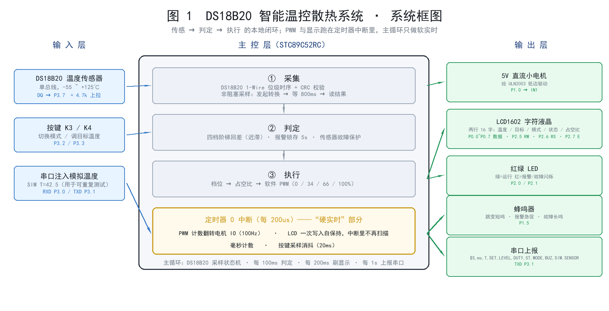
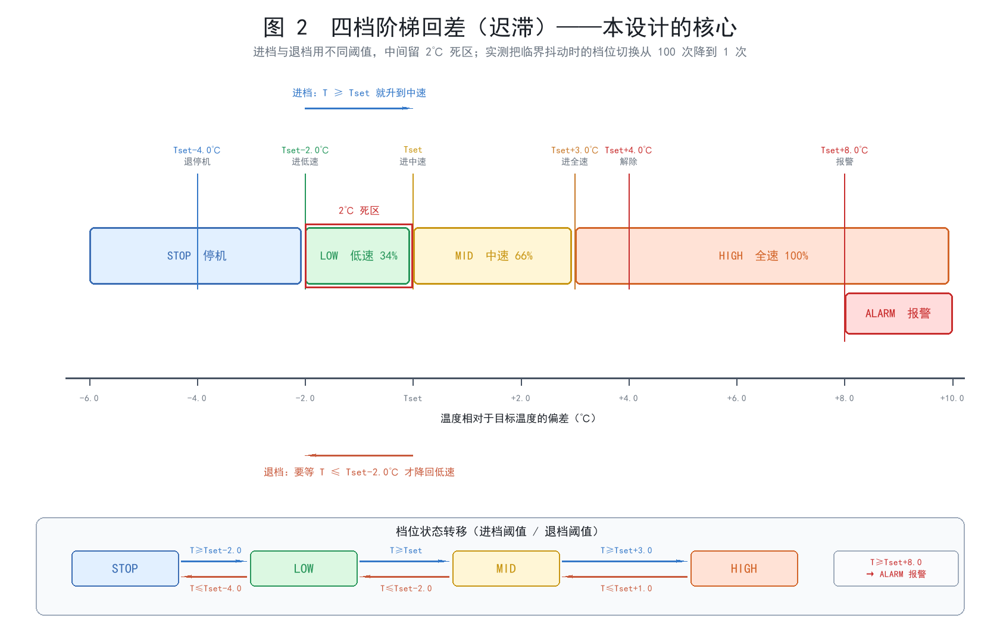

# DS18B20 智能温控散热系统 · 产品说明

> **课程作业**：《智能硬件》课程作品
> **平台**：STC89C52RC（8051 内核 @11.0592MHz）+ Keil C51
> **固件版本**：STC51-TempFan v1.0
> **文档中所有引脚、阈值、状态名均与 `firmware/config.h`、`firmware/app.c` 逐字一致**

---

## 0. 一句话介绍

> 一个自己会「量体温」、自己会「判断该转多快」的小型温控系统：
> 用 **DS18B20** 持续测量温度，以**目标温度**为中心划分四个调节档位，
> 用 51 单片机**纯软件 PWM** 驱动 5V 直流小电机分档调速，
> 并在 **LCD1602 字符液晶**上实时显示温度、目标温度、运行模式和占空比。

```
   温度变化 → DS18B20 → 四档阶梯回差判定 → 占空比 → 软件 PWM → 电机转速
        ↑                                                          │
        └──────────────── 闭环，每 100ms 判定一次 ─────────────────┘
```



---

## 1. 需求分析：作业要求 → 本作品的实现

| 作业要求 | 本作品的实现 | 在哪能看到 |
|---|---|---|
| 具有实际应用价值 | 面向"设备散热 / 恒温风扇"场景：机箱散热、养殖箱通风、小型恒温装置 | 本文档 §2 |
| 至少设计**两种**不同的输入状态或条件 | 实际做了 **3 类输入、6 种判定条件**：DS18B20 温度（连续量）、按键、串口注入温度；判定条件含"低于阈值 / 进入低速 / 进入中速 / 进入全速 / 超温报警 / 传感器故障" | §3.3 §3.4 |
| 系统能根据输入变化自动作出不同响应 | 4 档转速 + 报警 + 故障保护 + 手动接管，共 **8 种运行状态** | §3.4 §4 |
| 能现场展示**至少三种**运行状态 | 现场可稳定复现 **7 种**：停机 / 低速 / 中速 / 全速 / 报警 / 传感器故障保护 / 手动 | §4、`docs/08` |
| 通过重复测试证明按预期工作 | 逻辑层 **270/270 次**重复用例全通过；**5000 组**随机输入零违规；阶梯回差把临界抖动时的档位切换从 **100 次降到 1 次** | `docs/06` `docs/07` |
| 托管产品说明及程序至 GitHub | 完整仓库结构见 `README.md` | — |
| 通过图片、视频展示作品 | 4 张设计图见 `docs/images/`；视频拍摄脚本见 `docs/08` | — |

---

## 2. 产品定位与场景

**场景**：给发热设备做**自动风冷**。典型的有：

- 小功率电源 / 功放机箱的散热风扇
- 路由器、NAS 的辅助散热
- 小型恒温箱、孵化箱、育雏箱的通风调节
- 鱼缸灯、植物生长灯的散热

**痛点**：这类设备现在绝大多数还是两种极端——

1. **常转不停**：一通电风扇就全速转，安静场合吵得人心烦，还白白耗电、加速积灰。
2. **手动开关**：得自己去摸一下烫不烫，人不在就没人管。

**本产品的定位**：**不联网、纯本地、按需调速的闭环温控器。**
温度低就停，稍热就慢转，很热才全速；超温报警、传感器坏了也不瞎转。
全程在单片机上跑，不需要 App、不需要云、不需要 WiFi。

**差异化（讲解可直接引用）**：

| 对比对象 | 它们的做法 | 本产品的做法 |
|---|---|---|
| 常见的"温控风扇"课设 | `if (t > 30) fan = 1; else fan = 0;` —— 只有开和关两档，而且阈值附近会疯狂启停 | **四档阶梯回差**，进档退档用不同阈值；实测临界抖动时切换次数从 100 次降到 **1 次** |
| 用 PWM 模块的方案 | 买一个现成的 PWM 调速模块，单片机只发个开关信号 | **51 没有硬件 PWM**，本设计用定时器中断 + 软件计数从零实现，这才是真正的技术含量 |
| 只做显示的方案 | 只把温度显示出来，控制靠人 | 显示 + 判定 + 执行构成完整闭环 |
| 不管传感器死活的方案 | 传感器一坏就拿着最后一次的读数继续转 | **FAULT 保护**：连续 3 次读失败即判故障，电机强制停转并长鸣告警 |

---

## 3. 系统总体设计

### 3.1 三条核心设计原则

**原则一：阶梯回差（迟滞）——为什么必须有它。**

最朴素的写法是给每一档配一个阈值：

```
T ≥ 33℃ → 低速      T ≥ 35℃ → 中速      T ≥ 38℃ → 全速
```

问题在于：温度在 35.0℃ 上下抖动 0.1℃（传感器噪声、气流扰动都能造成），
档位就会在"低速 ↔ 中速"之间每秒来回跳好几次，电机跟着忽快忽慢，既吵又伤电机。

本设计的做法是给**每一次档位切换都配两个阈值**——进档一个、退档一个，中间留出死区：

| 切换 | 进档条件 | 退档条件 | 死区 |
|---|---|---|---|
| 停机 ↔ 低速 | T ≥ Tset − 2.0℃ | T ≤ Tset − 4.0℃ | 2.0℃ |
| 低速 ↔ 中速 | T ≥ Tset | T ≤ Tset − 2.0℃ | 2.0℃ |
| 中速 ↔ 全速 | T ≥ Tset + 3.0℃ | T ≤ Tset + 1.0℃ | 2.0℃ |

**实测效果：把温度在"进低速"阈值上下反复抖动 100 次，本设计只切换 1 次，而无回差方案切换 100 次——无效动作降低 99%。**



**原则二：档位是"一步一步爬"的，不是直接跳。**

温度一下子冲到 45℃ 时，档位不会从停机直接跳到全速，而是每 100ms 升一级：
停机 → 低速 → 中速 → 全速，用时约 300ms。

这相当于一个天然的**软启动**：电机不会瞬间承受全速冲击电流，
配合 470µF 电容，能显著减小对 5V 电源的冲击。
反过来温度骤降时也一样，一级一级退，不会让电机突然停转。

**原则三：安全优先——传感器不可信时，电机必须停。**

DS18B20 连续 3 次读取失败（约 3 秒）就判定为传感器故障，进入 `FAULT` 状态：
**电机强制停转** + 蜂鸣器长鸣告警 + 液晶显示 `T=  Err` 和 `FAULT`。

为什么不停在原地、或者拿最后一次的温度继续转？
因为最危险的场景恰恰是"电机自己把传感器烤坏了"——
如果这时还照着最后一次的低温读数继续转，就是火上浇油。
**读不到温度就当作"不知道有多热"，按最保守的方式处理。**

同理，报警（T ≥ Tset + 8℃）的优先级**高于手动模式**：
即使你手动把档位设成 0，只要温度越过报警线，系统依然会强制全速散热。
**安全逻辑永远压过人工指令。**

### 3.2 系统框图

见本文档开头的图 1。

### 3.3 输入设计（3 类输入）

| 编号 | 输入量 | 器件 | 接口 | 说明 |
|---|---|---|---|---|
| I1 | 温度 T | DS18B20 | **P3.7** 单总线（需 4.7kΩ 上拉到 +5V） | 定点 ×10 表示，350 即 35.0℃；分辨率 0.1℃ |
| I2 | 按键 ×2 | K3 / K4 | **P3.2 / P3.3**，低电平有效，内部/板上拉 | 20ms 采样、40ms 消抖、1.5s 判长按 |
| I3 | 串口注入温度 | USB-TTL | **P3.0 / P3.1**，9600 8N1 | 命令 `SIM T=42.5`，用于**可重复的自动化测试** |

**关于 I3「模拟温度注入」——这是本设计最实用的一处工程考虑。**

靠手捂住 DS18B20 让它升温，每次升多少、升多快都不一样，
**根本写不出可重复的测试报告**。所以固件内置了 SIM 模式：
收到 `SIM T=42.5` 后系统**完全忽略真实传感器**，改用注入值参与判定，
串口帧里 `SIM` 字段变成 1，一眼能看出当前用的是模拟数据。

于是同一组测试用例可以被精确复现任意多次，这才有了 `docs/07` 里
"270 次重复用例全部符合预期"这种可量化的结论。
SIM 模式也让**器件还没焊好之前**就能把控制逻辑跑通、把演示流程排练熟。

**关于按键为什么只用 K3/K4，不用 K1/K2。**

普中/清翔开发板上 K1 = P3.1、K2 = P3.0，而这两个脚正是串口的 RXD/TXD。
本项目要用串口做自动化测试，所以只占用 K3(P3.2)、K4(P3.3)，
把 P3.0/P3.1 完整留给串口 —— **按键和串口可以同时用，不需要拔线切换**。

### 3.4 判定逻辑

#### （1）参数表（默认值，均可在线修改）

| 参数 | 宏名 | 默认值 | 含义 |
|---|---|---|---|
| 目标温度 | `TSET_DEF` | **35.0 ℃**（值 350） | 四档划分的中心 |
| 目标温度可调范围 | `TSET_MIN` / `TSET_MAX` | **20.0 ~ 60.0 ℃** | 按键或串口在线调节 |
| 目标温度步进 | `TSET_STEP` | **1.0 ℃** | 按键每按一次变化量 |
| 进低速 | `LV_ENTER_LOW` | **Tset − 2.0 ℃** | |
| 退停机 | `LV_EXIT_LOW` | **Tset − 4.0 ℃** | |
| 进中速 | `LV_ENTER_MID` | **Tset + 0.0 ℃** | |
| 退低速 | `LV_EXIT_MID` | **Tset − 2.0 ℃** | |
| 进全速 | `LV_ENTER_HIGH` | **Tset + 3.0 ℃** | |
| 退中速 | `LV_EXIT_HIGH` | **Tset + 1.0 ℃** | |
| 报警阈值 | `ALARM_OFFSET` | **Tset + 8.0 ℃** | |
| 报警解除 | `ALARM_EXIT` | **Tset + 4.0 ℃** | 且需满足最短保持时间 |
| 报警最短保持 | `ALARM_HOLD_MS` | **5000 ms** | |
| 传感器故障判定 | `DS_FAIL_LIMIT` | **3 次** | 连续读失败次数 |
| 采样周期 | `DS_SAMPLE_MS` | **1000 ms** | |
| 转换等待 | `DS_CONV_MS` | **800 ms** | DS18B20 12 位转换需 750ms |

#### （2）判定流程（每个 100ms 周期执行一次）

```
第 1 步  取数据源
        仿真模式 ON  → 用注入的温度
        仿真模式 OFF → 用 DS18B20 最近一次成功读到的温度

第 2 步  传感器故障判定
        连续读失败次数 ≥ 3  →  fault = 1

第 3 步  报警锁存（最高优先级，带最短保持时间）
        cond = fault  或  (T ≥ Tset + 8.0℃)
        未报警 且 cond 成立                    → 报警置位，记录起始时刻
        已报警 且 cond 不成立
               且 T ≤ Tset + 4.0℃
               且 已保持 ≥ 5000ms              → 解除报警

第 4 步  阶梯回差决定档位（仅自动模式）
        按上表的"进档 / 退档"阈值逐级迁移，一次只走一级

第 5 步  合成状态与占空比
        fault                → ST_FAULT   档位 0   占空比 0%
        报警                 → ST_ALARM   档位 3   占空比 100%
        手动模式             → ST_MANUAL  档位 = 按键设定值
        自动模式             → ST_STOP / ST_LOW / ST_MID / ST_HIGH，按档位表取占空比
```

**第 3 步的"最短保持 5 秒"是很小但很重要的设计**：
温度瞬时冲高又立刻回落时，如果没有最短保持，报警会一闪而过，
人根本来不及反应。锁存 5 秒，保证操作者一定看得见红灯、听得见蜂鸣器。

### 3.5 输出设计

| 输出 | 引脚 | 驱动方式 | 表现 |
|---|---|---|---|
| 5V 直流小电机 | **P1.0** | 经 ULN2003 达林顿阵列低边驱动（或 S8050 三极管） | 软件 PWM 四档调速：**0% / 34% / 66% / 100%** |
| **LCD1602 字符液晶** | **P0.0~P0.7** 数据 D0~D7、**P2.6/P2.5/P2.7** = RS/RW/E | 8 位数据模式，只写不读<br>（普中板 LCD 专用插座，接线固定） | 两行 16 字：<br>行1 `T= 35.5C  SET=35`<br>行2 `AUTO MID    P= 66` |
| 双色 LED | 绿 **P2.0** / 红 **P2.1** | 低电平点亮 | 绿=电机在转；红=报警 2Hz 闪 / 故障 5Hz 闪；手动模式绿灯闪 |
| 蜂鸣器 | **P1.5** | 低电平响 | 档位跳变短鸣 60ms；报警 150ms 急促；故障 500ms 长鸣 |
| 串口上报 | **P3.1** | 9600 8N1 | `$S,ms,T,SET,LEVEL,DUTY,ST,MODE,BUZ,SIM,SENSOR` |

**软件 PWM 是怎么做出来的（这是本设计最值得讲的技术点）。**

8051 的定时器**没有 PWM 模式** —— 它只会定时中断，不像 STM32 有专门的 PWM 输出通道。
而 STC89C52 也没有 PCA 模块（那是 STC12/STC15 才有的）。所以只有一条路：

> 用定时器 0 每 **200µs** 中断一次，中断里让计数器 `pwm_cnt` 在 0~49 之间循环，
> `pwm_cnt < duty_cnt` 就把电机 IO 拉高，否则拉低。
> 于是 PWM 周期 = 50 × 200µs = **10ms**，频率 **100Hz**。

**为什么选 100Hz？**
- 频率太高 → 中断太频繁，51 的 CPU 会全花在进出中断上（实测 200µs 中断服务约占 18% CPU，已经是上限）；
- 频率太低（<50Hz）→ 电机会有明显抖动和可闻噪声；
- 100Hz 是这个晶振下的甜点：转速肉眼可见地平滑，且听不到刺耳啸叫。

**同一路中断还顺便干了另外三件事**（因为 Timer1 被串口波特率占用了，只有一个定时器可用）：

| 每 N 次中断 | 时间 | 干什么 |
|---|---|---|
| 1 次 | 200µs | PWM 计数并翻转电机 IO |
| 5 次 | 1ms | 毫秒计数 +1 |
| ~~10 次~~ | ~~2ms~~ | ~~扫描一位数码管~~ —— **改用液晶后这一路去掉了**，液晶自带控制芯片，写入后自己保持显示 |
| 100 次 | 20ms | 按键采样与消抖 |

这带来一个额外的好处：**电机转速和按键响应都不会被主循环里的耗时操作影响**。
DS18B20 采样、串口解析、状态判定全在主循环里，哪怕某一轮慢了几毫秒，
电机转速和显示也纹丝不动。

### 3.6 数码管显示布局

8 位数码管，从左到右：

```
 ┌───┬───┬───┬───┬───┬───┬───┬───┐
 │   │ 3 │ 5.│ 5 │ - │ 3 │ 5 │ 2 │    实测 35.5℃   目标 35℃   当前 2 档
 └───┴───┴───┴───┴───┴───┴───┴───┘
   百  十  个  十分  分隔  目标   目标   状态
   位  位  位   位         十位   个位   位
```

- **位 0~3**：实测温度，格式 `XXX.X`（自动省略前导零，负温显示 `-` 号）
- **位 4**：`-` 分隔符
- **位 5~6**：目标温度整数部分（20~60）
- **位 7**：状态位 —— 自动模式显示档位数字 `0~3`，手动模式显示 `H`，
  报警显示 `A`，传感器故障显示 `F`
- 传感器故障时，位 0~3 改显示 `Err`
- **报警时整屏以 300ms 周期闪烁**，现场一眼就能看到

---

## 4. 完整运行状态对照表

系统对外呈现 **8 种具名状态**（由 `app.c` 的 `app_state_name()` 唯一确定），
液晶上显示英文缩写，串口日志上报同样的名字，便于自动化测试比对。

| 状态名（串口） | 液晶第 2 行 | 触发条件 | 档位 | 占空比 | 绿灯 | 红灯 | 蜂鸣器 |
|---|---|---|---|---|---|---|---|
| `INIT` | — | 上电后、首次采样完成前 | 0 | 0% | 灭 | 灭 | 静音 |
| `STOP` | `0` | T < Tset − 2.0℃ | 0 | **0%** | 灭 | 灭 | 静音 |
| `LOW` | `1` | Tset − 2.0℃ ≤ T < Tset | 1 | **34%** | 常亮 | 灭 | 静音 |
| `MID` | `2` | Tset ≤ T < Tset + 3.0℃ | 2 | **66%** | 常亮 | 灭 | 静音 |
| `HIGH` | `3` | Tset + 3.0℃ ≤ T < Tset + 8.0℃ | 3 | **100%** | 常亮 | 灭 | 静音 |
| `ALARM` | `A` | T ≥ Tset + 8.0℃ | 3 | **100%** | 灭 | 2Hz 闪 | 150ms 急促鸣叫 |
| `FAULT` | `F` | DS18B20 连续 3 次读失败 | 0 | **0%** | 灭 | 5Hz 快闪 | 500ms 长鸣 |
| `MANUAL` | `H` | 按 K3 切到手动模式 | 按键设定 | 按键设定 | 250ms 闪 | 灭 | 静音 |

> **状态与档位是两个维度。** 状态是给人看的"现在什么情况"，
> 占空比是给硬件的"电机该转多快"。
> 比如手动模式下温度很高，状态显示 `MANUAL`，档位完全按你的设定走——
> 但只要温度越过报警线，状态会立刻变成 `ALARM` 并强制全速（安全优先）。

---

## 5. 按键操作

只有两个按键，靠"短按 / 长按 / 按住连发"和模式区分实现了全部操作：

| 操作 | 自动模式下 | 手动模式下 |
|---|---|---|
| **K3 短按** | 切到手动模式 | 切回自动模式 |
| **K3 长按 1.5s** | 恢复默认（目标温度回到 35.0℃，切回自动） | 同左 |
| **K4 短按** | 目标温度 +1.0℃（上限 60.0℃） | 档位循环 0 → 1 → 2 → 3 → 0 |
| **K4 按住不放** | 每 200ms 自动 +1.0℃，快速把目标温度拉到底 | 同左（连续切档） |

> **K4 调目标温度这个设计是「为现场演示量身定做」的**：
> 把目标温度从 35℃ 一路按到 20℃，25℃ 的室温立刻让系统从"停机"跳到"全速"，
> 电机"嗡"地一声转起来，液晶状态从 `STOP` 跳到 `HIGH`、占空比从 `0` 跳到 `100` —— **完全不需要真的加热**。
> 反过来把目标温度按到 60℃，电机立刻停转。
> 这是演示现场最有效的一招。

---

## 6. 关键设计决策一览（讲解速查）

| 决策 | 为什么这么做 | 不这么做会怎样 |
|---|---|---|
| 四档阶梯回差（每档两个阈值） | 消除临界点的档位抖动 | 电机在阈值附近每秒启停十几次，噪声大、冲击大、寿命短 |
| 档位一级一级爬 | 天然软启动，减小电流冲击 | 温度一冲高就全速，电源被拉垮，可能引起复位 |
| 报警锁存 + 最短保持 5s | 安全事件必须看得见、听得够 | 瞬时超温一闪而过，人根本没注意 |
| 报警优先级高于手动模式 | 安全压过人工指令 | 手动设成 0 档时，超温也不散热，可能烧设备 |
| FAULT 时电机强制停 | 传感器不可信时不能瞎转 | 若是电机把传感器烤坏了，继续转会火上浇油 |
| 纯软件 PWM（定时器中断） | STC89C52 没有硬件 PWM 和 PCA | 只能用"全速 / 停"两档，失去调速的意义 |
| PWM 选 100Hz | 高于听觉敏感的抖动频率，又不至于吃满 CPU | 太低会抖、会响；太高 51 算不过来 |
| 一个定时器中断干三件事 | Timer1 被串口波特率占用了，只剩 Timer0。改用液晶后不再需要数码管扫描，中断服务更短 | 做不到，必须牺牲按键响应 |
| 按键扫描放在中断里 | 主循环会被 DS18B20 采样等操作占用 | 按键迟钝、漏按 |
| DS18B20 非阻塞采样 | 转换要 750ms，死等的话主循环卡住 | 串口命令要排队、按键失灵 |
| DS18B20 读暂存器时做 CRC 校验 | 单总线容易被干扰，错误数据比没有更危险 | 偶发读到错误温度，档位乱跳 |
| 温度用定点 ×10 而非浮点 | 8051 上 float 运算慢且极占 Flash | 代码膨胀、判定周期变长 |
| 大缓冲放 `xdata` | STC89C52 只有 128 字节可直接寻址 RAM | `data` 空间溢出，Keil 报 L107 |
| 串口收 + 发都做中断驱动 | 阻塞发送会占用约 1ms/字节，期间丢接收字节 | 自动化测试"发命令→立刻读响应"必丢数据 |
| 中文/字符串放 `code` 空间 | 51 的 RAM 只有几百字节 | RAM 瞬间用光 |
| 按键只用 K3/K4，让开 P3.0/P3.1 | 那两个脚是串口 RXD/TXD | 按键和串口二选一，测试时要拔线 |
| 提供 SELFTEST 自检模式 | 各家开发板引脚定义不完全一致 | 出问题时只能靠猜是哪个引脚接错了 |

---

## 7. 性能指标

| 指标 | 数值 |
|---|---|
| 主控主频 | 11.0592 MHz（12 个时钟/机器周期 → 1.085µs/机器周期） |
| **Flash 占用** | **5905 / 8192 字节（72%）**（正式固件）；自检固件 7866 字节 |
| **`data` RAM 占用** | **93 / 128 字节（73%）** —— 8051 最紧张的资源，还要给栈留 35 字节 |
| **`xdata` RAM 占用** | **175 / 256 字节（68%）**（串口收发缓冲 + 状态机的状态变量） |
| **编译结果** | Keil C51 V9.60.7 实测：11 个模块**编译 0 警告 0 错误**，**链接 0 错误** |
| PWM 频率 / 分辨率 | **100 Hz / 50 级**（占空比 0% / 34% / 66% / 100%） |
| 定时器中断周期 | 200 µs，中断服务约 35µs → CPU 占用约 **18%** |
| 状态判定周期 | 100 ms |
| 温度采样周期 | 1000 ms（其中 DS18B20 转换占 800ms，总线空闲，主循环不受影响） |
| 液晶刷新周期 | 200 ms 全屏重写（约 2.6ms 写完 32 个字符，占 CPU 1.3%） |
| 按键响应 | 20 ms 采样 + 40 ms 消抖，长按判定 1.5s |
| 串口 | 9600 8N1（11.0592MHz 下误差 **0.00%**） |
| 串口上报周期 | 1000 ms，状态变化时立即补发 |
| 温度分辨率 / 范围 | 0.1℃（内部 12 位）/ −55.0 ~ +125.0℃ |
| 最大关中断时间 | 约 90 µs（仅 1-Wire 单个位的读写窗口） |
| 档位抖动次数（阈值 ±0.1℃ 抖动 100 次） | **1 次**（无回差方案为 100 次） |
| 温度缓变全程切换次数（20→60→20℃） | **6 次**（与理论值完全一致） |
| 逻辑层重复测试通过率 | **270 / 270 = 100%** |
| 随机模糊测试 | **5000 组输入，0 处违反设计不变式** |

---

## 8. 创新点（相对常规课设）

1. **阶梯回差并用数据量化其价值**：不是"我加了迟滞"一句话，而是
   "临界抖动 100 次时档位切换从 100 次降到 1 次，降低 99%"。
2. **在没有任何硬件 PWM 的 51 上实现四档软件 PWM**，
   并把 PWM、毫秒计时、按键采样**塞进同一个定时器中断**，
   用约 13% 的 CPU 占用换来电机与显示的完全稳定。
3. **非阻塞的 DS18B20 采样状态机**：把 750ms 的转换等待拆到主循环里，
   期间照常响应按键和串口 —— 这是通常只在更高级的 MCU 上才做的处理。
4. **内置 SIM 模拟温度注入模式**：把"用热源烤传感器"变成**可 100% 复现的自动化回归测试**，
   并在器件到货前就能完成全部逻辑验证。
5. **安全优先的降级策略**：传感器故障时电机强制停转（而不是沿用旧读数），
   报警优先级高于手动指令。
6. **全套自动化质量保障**：即使在没有 C 编译器、也没有硬件的环境下，
   也用「Python 静态自检（含 C89 块内声明检查）+ Python 等价仿真 + 5000 组模糊测试」
   把逻辑正确性验证到位（见 `tools/lint_c51.py`、`tools/sim_controller.py`）。
7. **引脚自检程序**：`SELFTEST_MODE` 打开后逐个演示每个外设，
   30 秒就能确认接线、定位问题 —— 这是面对"各家开发板引脚定义不一致"的工程化应对。

---

## 9. 局限与改进方向

| 局限 | 影响 | 改进方向 |
|---|---|---|
| DS18B20 转换一次要 750ms，采样周期只能到 1s | 对快速温变响应慢 | 换 SHT30（I2C，转换时间 <15ms）；或降低到 9 位分辨率（93.75ms，0.5℃） |
| 100Hz PWM 在最低档（34%）时低速性能一般 | 超低速时电机可能只发声不转 | 换 STC15/STC12，用硬件 PCA/PWM 把频率提到 20kHz；或换带减速箱的电机 |
| 按键只有 2 个，靠长短按复用 | 操作不够直观 | 换旋转编码器（旋钮调温度，体验好得多） |
| 参数掉电不保存 | 每次上电都要重新设目标温度 | 把参数写进 STC 内部的 EEPROM/DataFlash（STC89C52 需要额外的 IAP 操作） |
| 只有一路温度，没有冗余 | 传感器坏了只能停 | 加一路 NTC 热敏电阻做交叉校验，两路偏差过大也判故障 |
| LCD1602 只能显示 ASCII，不能显示中文 | 界面只能是英文缩写 | 换 0.96" I2C OLED，能显示中文和趋势曲线 |
| 没有看门狗 | 极端情况下跑飞不会自恢复 | 启用 STC 内置的看门狗定时器，主循环定期喂狗 |
| Keil C51 未注册版有 2KB 代码限制 | 无法直接编译 | 见 `docs/04` 的三种解决办法（注册 / 换 SDCC / 裁剪） |

---

## 10. 相关文档索引

| 文档 | 内容 |
|---|---|
| [`README.md`](../README.md) | 项目总览与快速开始 |
| [`02-选型与采购清单.md`](02-选型与采购清单.md) | 已有装备盘点、缺口元件清单、预算、12 个新手避坑点 |
| [`03-硬件接线与引脚分配.md`](03-硬件接线与引脚分配.md) | 逐引脚接线表、**电机驱动电路**、上电前自检清单 |
| [`04-Keil编译与下载.md`](04-Keil编译与下载.md) | Keil C51 建工程、编译设置、STC-ISP 下载、常见报错 |
| [`05-测试方案与判定标准.md`](05-测试方案与判定标准.md) | 三层测试方案、14 条 L2 用例、12 个 L3 物理场景、记录表模板 |
| [`06-测试记录-自动生成.csv`](06-测试记录-自动生成.csv) | 270 条逐条测试原始记录 |
| [`07-测试报告-自动生成.md`](07-测试报告-自动生成.md) | 测试结论、阶梯回差专项验证、模糊测试不变式 |
| [`08-现场演示流程.md`](08-现场演示流程.md) | 6 分钟演示流程、18 个讲解预案、翻车急救表 |
| [`09-制作过程问题与解决办法.md`](09-制作过程问题与解决办法.md) | 18 个真实踩坑与解决办法 |
